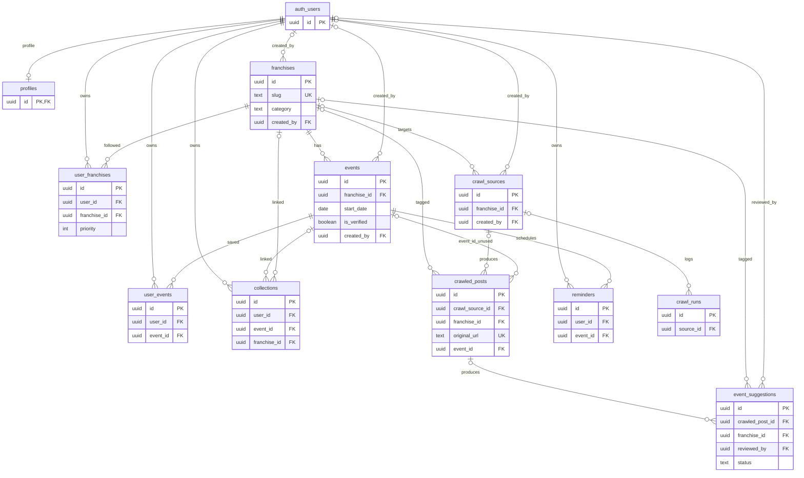
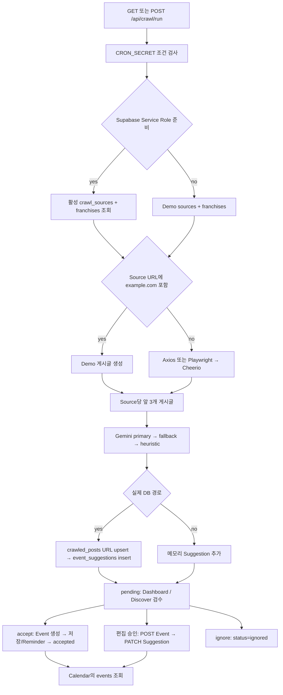

# OtakuHub — Current Implementation Snapshot

## 0. Snapshot

| 항목 | 조사 기준 |
| --- | --- |
| 조사일 | 2026-10-04, Asia/Seoul |
| Repository | https://github.com/NoNamad5196/OtakuHub |
| 로컬 체크아웃 | `C:/Users/nonam/Documents/OtakuHub` |
| 기준 Branch | `main` |
| 기준 Commit | `245dadb2008b6cd6e95e5c3766c08150964228e3` |
| Commit 시각 / 제목 | 2026-10-04 06:16:41 +09:00 / `Complete demo flows, add Agent APIs and automatic palettes` |
| 로컬 `origin/main` | 기준 Commit과 일치. 로컬에 저장된 remote-tracking ref임 |
| GitHub 최신 `main` | **UNKNOWN**. `git ls-remote origin refs/heads/main`이 github.com:443 연결 실패로 종료되어 최신 원격 Commit 미확인 |
| 조사 시작 상태 | 추적 파일의 staged/unstaged 변경 없음. 기존 미추적 `OtakuHub.zip` 1개 존재 |
| 코드 조사 범위 | 추적 파일 98개 목록과 현재 소스·설정·SQL·타입·테스트 확인. Page 7개, API route 파일 13개, Auth callback 1개, 테스트 파일 12개 |
| 외부 시스템 | 운영 DB, Google OAuth 설정, 실제 크롤 대상, Gemini 실호출, Vercel 운영 배포에 접속하거나 데이터를 변경하지 않음 |
| 산출물 | 이 문서 하나. 코드·설정·패키지·SQL 수정, 설치, Migration 실행, 기존 소스 파일 삭제·이동 없음 |

이 문서의 CURRENT는 **해당 Commit의 코드에 실행 경로가 존재한다**는 의미이다. 운영 DB에 Migration이 적용되었거나 외부 서비스가 정상 작동한다는 증명은 아니다. 근거 표기 `[Sxx]`는 18절의 파일 및 기준 Commit 링크에 대응한다. README의 설명과 실제 구현이 다르면 코드를 따른다.

상태 표기의 의미:

| 상태 | 의미 |
| --- | --- |
| CURRENT | 실제 코드·스키마·호출 경로가 존재함. 운영 검증 범위는 별도 표기 |
| PARTIAL | 일부 경로·UI·스키마만 존재하거나 전체 사용자 흐름이 완성되지 않음 |
| ISSUE | 현재 코드에서 오류, 불일치 또는 무결성·권한상의 결함을 확인함. 운영 영향이 미확인인 경우 명시 |
| PLANNED | 현재 코드의 문구 등에 향후 제공 계획이 명시되어 있으나 구현 경로는 없음 |
| UNKNOWN | 외부 상태, 조사 범위 밖의 구현 또는 실행 결과를 확인할 수 없음 |

15~16절은 **통합 시 검토 판단**이다. 그 내용을 현재 구현으로 읽으면 안 된다. SipSungJang과 GachaGuard의 Repository 코드는 조사하지 않았다.

## 1. Executive Summary

OtakuHub는 Next.js App Router 기반의 한국어 일정·굿즈 관리 웹앱이다. 실질적인 화면은 Dashboard, Discover, Calendar, Collections, Settings의 5개이며, 루트는 Dashboard로, 기존 Franchises 경로는 Settings의 게임 관리 영역으로 이동한다.

현재 데이터 경로는 Supabase와 프로세스 메모리 데모의 두 가지이다. 일반 화면과 읽기 API는 Supabase 조회 실패 때 전체 데모 데이터로 전환한다. 일반 쓰기 API는 Supabase 공개 환경변수 존재 여부로 경로를 결정하며, 실패했다고 데모 쓰기로 전환하지 않는다. 크롤러는 Service Role 환경변수 존재 여부로 별도 결정한다. Agent 실행 신호·과금 알림은 Supabase 설정과 관계없이 메모리에 저장한다. 따라서 하나의 일관된 운영 모드라고 볼 수 없다. [S03], [S04], [S05], [S06], [S08]

핵심 흐름인 Source → 게시글 수집 → Gemini 또는 로컬 추정 → Suggestion → 검수 → Event → Calendar는 코드에 존재한다. 다만 게시글 URL의 upsert와 한 번의 HTML 파싱 내 중복 제거만 있으며, 재수집 시 Suggestion 중복, 반복 승인 시 Event 중복을 막지 않는다. 수정 후 승인은 Event 생성과 Suggestion 상태 변경의 별도 요청이다. 승인된 Event와 원래 Suggestion/Post 사이의 최종 연결도 기록되지 않는다. [S05], [S07], [S08], [S09], [S13]

게임은 별도 Game 엔티티가 아니라 `franchises.category = 'game'`이다. `games`, `user_games`, 공통 Account 모델, 외부 게임 ID 매핑 테이블이 없다. 관심 관계를 위한 `user_franchises`는 SQL·타입·조회가 있지만 등록·해제 Mutation은 없다. “내 게임 추가”는 관심 등록 대신 공개 Franchise를 새로 만든다. [S01], [S02], [S04], [S05], [S16]

Supabase Auth의 Google 로그인과 JWT claims 기반 서버 인증, 사용자 소유 데이터의 RLS 정책이 구현되어 있다. 페이지 진입 제한이나 관리자 검수 권한은 없다. 모든 로그인 사용자가 모든 Suggestion을 조회·검수할 수 있고, 수동 생성과 승인은 바로 `is_verified = true`를 설정한다. SQL에 Franchise/Event 쓰기 정책은 있지만 authenticated에 대한 명시적 INSERT/UPDATE GRANT는 빠져 있다. 실제 DB의 상속/default privileges는 UNKNOWN이다. [S01], [S05], [S10], [S11]

알림 발송, Google Calendar 동기화, 프로필 편집, 계정 삭제, JSON 내보내기 등은 완성된 기능이 아니다. 일부는 화면 상태나 버튼만 존재한다. 타입 검사, 테스트 12파일/27개, 프로덕션 빌드는 통과했지만 ESLint는 오류 1건·경고 1건으로 실패했다. 실제 Production 배포 상태는 UNKNOWN이다.

## 2. Tech Stack

버전은 `package.json`의 범위와 `package-lock.json`의 해석된 버전을 구분했다. 아래 주요 패키지의 기존 `node_modules` 버전도 lockfile과 일치하는 것을 확인했다. 설치·업데이트는 하지 않았다. [S20]

| 영역 | 선언 | 잠긴 버전 / 실제 사용 |
| --- | --- | --- |
| Framework | `next: latest` | Next.js **16.2.6**, App Router, React Server Components, Route Handlers, `src/proxy.ts` |
| React | `react/react-dom: latest` | **19.2.6 / 19.2.6** |
| TypeScript | `typescript: latest` | **5.9.3**, strict, bundler module resolution, noEmit |
| 실행 Runtime | 프로젝트 `engines`, `.nvmrc` 등 없음 | 로컬 Node **24.12.0**, npm **11.6.2**. 배포 Node 버전 UNKNOWN |
| Supabase SSR / Client | `latest` | **0.10.3 / 2.105.3**, Auth·Postgres API |
| Calendar | `@fullcalendar/*: ^6.1.15` | core/daygrid/interaction/react/timegrid **6.1.20** |
| 날짜 | `dayjs: ^1.11.13` | **1.11.20**, 한국어 locale. 명시적 timezone 플러그인 없음 |
| Crawling | `axios: ^1.7.9`, `cheerio: ^1.0.0`, `playwright: latest` | **1.16.0 / 1.2.0 / 1.59.1**. 모두 크롤러 코드에서 사용 |
| Validation | `zod: ^3.24.1` | **3.25.76**, 일반 API 입력·Agent 입력·AI 출력 검사 |
| UI/CSS | Tailwind·PostCSS `latest` | **4.2.4**, 로컬 UI primitives, CSS 변수 |
| 아이콘/컴포넌트 | `lucide-react: latest`, Radix Slot | **1.14.0 / 1.2.4** |
| 스타일 유틸리티 | cva / clsx / tailwind-merge | **0.7.1 / 2.1.1 / 2.6.1** |
| Lint | ESLint / eslint-config-next | **9.39.4 / 16.2.6**, flat config |
| Test | `vitest: latest` | **4.1.5**, Node environment |
| AI | 전용 AI SDK 의존성 없음 | 네이티브 `fetch`로 Gemini Developer API 호출 |

Next의 Node 요구사항은 lockfile상 `>=20.9.0`, Cheerio는 `>=20.18.1`이다. 프로젝트 자체 Runtime 버전 고정은 없다. `next.config.ts`는 `serverExternalPackages: ["playwright"]`만 설정한다.

| Script | 실제 명령 |
| --- | --- |
| `dev` | `next dev --turbopack` |
| `build` | `next build` |
| `start` | `next start` |
| `typecheck` | `tsc --noEmit` |
| `lint` | `eslint .` |
| `test` | `vitest run` |
| `test:watch` | `vitest` |
| `verify` | `npm run typecheck && npm run test && npm run build` — **lint를 포함하지 않음** |

## 3. Repository Structure

```text
OtakuHub/
├─ src/
│  ├─ app/
│  │  ├─ layout.tsx, page.tsx, globals.css
│  │  ├─ dashboard/, discover/, calendar/, collections/, settings/
│  │  ├─ franchises/                  # /settings#games로 redirect
│  │  ├─ auth/callback/route.ts
│  │  └─ api/
│  │     ├─ franchises/ (+ palette/)
│  │     ├─ events/ (+ [id]/save/)
│  │     ├─ collections/
│  │     ├─ suggestions/ (+ [id]/accept/, [id]/ignore/)
│  │     ├─ crawl/run/
│  │     └─ integrations/agent/        # config/events/activity/spending-alert
│  ├─ components/
│  │  ├─ app-shell, auth-button, dashboard-client, suggestion-review
│  │  ├─ calendar-client, collection-manager, settings-client
│  │  ├─ active-nav-link, event-creator, franchise-manager
│  │  ├─ page-header, stat-card
│  │  └─ ui/                         # badge/button/card/input/label/table/textarea
│  ├─ lib/
│  │  ├─ data.ts, types.ts, database.types.ts
│  │  ├─ demo-data.ts, mock-store.ts, palette.ts
│  │  ├─ date-utils.ts, event-labels.ts, utils.ts
│  │  ├─ supabase/                    # env/client/server/proxy
│  │  ├─ repositories/                # auth/dashboard/mappers/mutations/crawler
│  │  ├─ crawlers/                    # index/types/html-parser/naver-lounge/dc/official/demo-posts
│  │  ├─ ai/extract-event.ts
│  │  ├─ integrations/agent.ts
│  │  └─ api/errors.ts
│  └─ proxy.ts
├─ supabase/
│  ├─ migrations/202605080001_initial_schema.sql
│  └─ seed.sql
├─ package.json, package-lock.json, tsconfig.json, next-env.d.ts
├─ next.config.ts, vercel.json, vitest.config.ts, eslint.config.mjs
├─ postcss.config.mjs, components.json, .env.example, .gitignore, README.md
└─ docs/OTAKUHUB_CURRENT_IMPLEMENTATION.md  # 이번 조사 산출물
```

테스트는 대상 코드 옆의 `*.test.ts`로 배치되어 있다. 추적된 `pages/`, 별도 백엔드 앱, monorepo workspace, 공용 패키지, `.github/workflows/`, Supabase CLI config는 없다. `public/`도 추적 파일 목록에 없다.

기존 로컬 `node_modules/`, `.next/`, `.vercel/`, `tsconfig.tsbuildinfo`는 Git ignore 대상이다. `.vercel/project.json`에는 `projectName: otakuhub` 연결 흔적이 있지만 배포 성공이나 Production URL의 증거가 아니다. 기존 `OtakuHub.zip`은 추적 소스의 일부로 사용하지 않았고 열거나 변경하지 않았다.

## 4. Frontend Architecture

### 4.1 공통 조회·렌더링

`RootLayout`과 데이터가 필요한 각 Page는 서버에서 `getDashboardData()`를 호출한다. Page의 최초 데이터 로딩은 내부 HTTP API를 거치지 않고 Repository를 직접 호출한다. Client Component에서 사용자가 작업하면 `fetch("/api/...")`로 Mutation을 수행한다. 별도 Server Action은 없다. `<form action={submit}>`의 `submit`도 Client Component의 로컬 함수이다. [S03], [S04], [S12], [S13], [S14], [S15], [S16], [S17]

RootLayout은 `dynamic = "force-dynamic"`, 한국어 HTML, 공통 AppShell, pending Suggestion 수, 테마 초기 스크립트를 제공한다. 데이터 요청의 명시적 캐시·페이지별 분할·페이지네이션은 없다. 각 화면이 컬렉션·소스·리마인더까지 포함하는 큰 DashboardData를 공통으로 읽는다. 현재 코드에서 Layout과 Page의 조회를 하나로 합치는 캐시도 확인되지 않는다.

### 4.2 전체 Page/Route

| 경로 | 화면/동작 | 읽는 데이터 | 실제 Mutation / API 연결 |
| --- | --- | --- | --- |
| `/` | `/dashboard`로 서버 redirect | 공통 Layout 조회 | 없음 |
| `/dashboard` | 수집 요약, AI 검수 대기 최대 3건, 14일 내 일정 최대 5건, 위시 최대 5건, 소스 상태 | franchises/events/collections/sources/suggestions/crawlRuns | `POST /api/crawl/run`, `POST /api/suggestions/{id}/accept\|ignore`; 성공 시 로컬 상태 변경·`router.refresh()` |
| `/discover` | 소스, AI 제안, 승인 완료 탭. 날짜·장소·confidence·warnings·원문 링크·검수 | franchises/sources/suggestions/crawlRuns | Crawl, accept, ignore. 편집 승인은 `POST /api/events` → `PATCH /api/suggestions` |
| `/calendar` | FullCalendar 월/주, 이전/다음/오늘, 유형·Franchise 필터, 선택 날짜·향후 8건 | events/franchises | 수동 일정 모달 → `POST /api/events`; 성공 시 refresh |
| `/collections` | 굿즈 표/그리드, 검색·Franchise·위시/구매/예약 필터, 합계 | collections/franchises/events | 추가 모달 → `POST /api/collections`; 반환 항목을 로컬 배열에 추가 |
| `/settings` | 프로필·알림·캘린더 연동·Agent·게임·테마·계정·환경 설정 여부 | DashboardData, 서버의 환경변수 존재 여부 boolean | 실제 서버 쓰기는 `POST /api/franchises`. 팔레트는 `GET /api/franchises/palette`. 테마는 localStorage. 나머지는 아래 표 참고 |
| `/franchises` | `/settings#games`로 서버 redirect | 공통 Layout 조회 | 자체 관리 화면 없음 |
| `/auth/callback` | OAuth code 교환 후 `/dashboard` redirect | query `code`, Supabase Auth | `exchangeCodeForSession`; Auth callback Route Handler |

별도 `/games`, Event 상세, Franchise 상세, 로그인 Page, 관리자 Page, 알림 Page는 없다. Source 관리는 Discover 탭 내부에 표시되지만 CRUD 화면은 없다.

### 4.3 화면별 세부 동작

- **Dashboard:** 일정은 `saved`나 관심 Franchise로 제한하지 않는다. “2주 일정” 숫자는 이미 `slice(0, 5)`된 배열 길이여서 최대 5건이다. 수집 집계는 가장 최근 **한 Source run**에서 가져오며 전체 실행 합계가 아니다. run이 없으면 `activeSources.length * 4` 등 추정 숫자를 표시한다. “AI 파이프라인 운영 중”, “Gemini가 … 스캔”, “내일 오전 3:00”은 실제 모델·Cron 상태를 조회한 결과가 아니다. [S12]
- **Discover:** pending/accepted만 탭에 노출하며 ignored 목록은 별도 탭이 없다. 편집 가능한 항목은 title/startDate/endDate/location이며 Franchise나 eventType 편집은 없다. Source 추가와 옵션 버튼에는 핸들러가 없다. 파이프라인 진행 단계는 setTimeout으로 연출하고 중간 posts=12를 넣는다. 완료 후 API 결과로 대체하지만 실시간 진행 이벤트는 아니다. [S13]
- **Calendar:** 전달받은 events 전체를 표시한다. `saved === true`나 `isVerified === true`를 추가 필터링하지 않는다. RLS로 읽을 수 있는 미검증 본인 Event도 표시 가능하다. 수동 생성도 즉시 표시되므로 “AI 검수 후 반영된 일정만”이라는 문구는 실제 조건과 다르다. Event 클릭 편집·삭제·드래그 저장, 외부 Calendar 동기화는 없다. [S14]
- **Collections:** 상태 필드는 따로 없고 `!isWishlist → purchased`, 그 외 memo에 “예약” 또는 “발매” 포함 시 reserved, 나머지 wishlist이다. 예약은 wishlist에 포함되므로 위시 총액과 위시 탭 개수가 다를 수 있다. “이번 달 지출”은 날짜 필터 없이 구매 항목 전체 가격의 합계다. “다음 발매 예정”도 첫 reserved 항목이며 발매일 순 정렬이 아니다. 기존 항목 수정·삭제·구매 전환의 API/핸들러는 없다. [S15]
- **게임 추가:** Settings의 로컬 Franchise 배열만 갱신하며 `router.refresh()`를 호출하지 않아 AppShell의 목록이 즉시 갱신된다고 보장되지 않는다. 제거 아이콘은 핸들러가 없다. 모든 보이는 Franchise를 “내 게임”으로 표시하며 category=game 또는 user_franchises 존재 여부로 제한하지 않는다. [S16], [S17]

### 4.4 Settings의 실제 구현 경계

| 항목 | 실제 처리 | 상태 |
| --- | --- | --- |
| 프로필 표시 | 이름·이메일·아바타 문자 하드코딩. `profiles` 조회 없음 | PARTIAL |
| 프로필 편집 / 언어 선택 | 편집 버튼 무동작, 언어 Pill callback은 빈 함수 | PARTIAL |
| 알림 4종 / 알림 시점 | React state만 변경, API·DB·localStorage 저장 없음 | PARTIAL |
| Google Calendar | 초기 `gcalLinked=true`, 연결/해제는 boolean toggle만 수행. 동기화 시각 문구 고정 | ISSUE |
| Apple / Outlook | “곧 제공”, iCal URL 예정 문구만 존재 | PLANNED |
| Agent 정보 | 실제 4개 API 경로·토큰 존재 여부 표시. 타 앱 연결 상태 조회 없음 | PARTIAL |
| 게임/Franchise 추가 | 팔레트 조회 후 Franchise 생성 API | PARTIAL — 관심 관계 등록 아님 |
| 테마 | light/dark/system, `otakuhub-theme` localStorage, HTML dataset/CSS 변경 | CURRENT |
| 내보내기 / Settings 로그아웃 / 계정 삭제 | 버튼만 존재, 핸들러 없음 | PARTIAL |
| 시스템 상태 | Supabase/Gemini/Cron 환경변수 존재 여부 표시. health check 아님 | PARTIAL |

실제 로그아웃은 Settings의 버튼이 아니라 AppShell의 AuthButton에서 수행한다.

system 테마는 앱 초기 스크립트에서 한 번 해석한다. OS 테마 변경 listener는 SettingsClient에만 있어 다른 화면에 머무는 동안 system 변경을 지속 구독하는 공통 Provider는 없다.

### 4.5 Navigation 및 Components

AppShell은 Desktop sidebar와 `lg` 미만 화면용 햄버거·슬라이드 sidebar·닫기 overlay를 제공한다. 이동 시 모바일 메뉴를 닫는다. 5개 메인 링크의 active 상태와 Discover pending badge, priority/name 정렬 Franchise 목록, AuthButton이 있다. Sidebar 사용자 이름과 베타 표시도 하드코딩이다. 키보드 focus trap·Escape 처리·자동 body scroll lock은 별도 구현되지 않았다. [S17]

| Component | 연결 상태 |
| --- | --- |
| AppShell / AuthButton | RootLayout에서 사용 |
| DashboardClient / PageTop | Dashboard와 다른 현재 화면의 공통 헤더 |
| SuggestionReview / CalendarClient / CollectionManager / SettingsClient | 각 Page에서 실제 사용 |
| FranchiseManager / EventCreator | 생성 API에 연결된 구현은 남아 있지만 현재 Page import/렌더링 없음 |
| ActiveNavLink / PageHeader / StatCard | 파일·export 존재. 현재 앱에서 사용처 없음 |
| UI primitives | Badge/Button/Input 중심으로 사용. Card/Label은 잔존 Component에서도 사용. Table/Textarea는 import 사용처 없음 |

## 5. Authentication

### 5.1 로그인·Session

| 항목 | 현재 코드 |
| --- | --- |
| 인증 시스템 | Supabase Auth. NextAuth/Auth.js 구현·의존성 없음 |
| Provider | Google 하나. `signInWithOAuth({ provider: "google" })` |
| Redirect | 현재 브라우저 origin + `/auth/callback`; 완료 시 서버가 `/dashboard` redirect |
| Client Session | `@supabase/ssr` browser client, `getUser()`, `onAuthStateChange` |
| Server Session | cookie 기반 SSR client, `cookies().getAll/setAll` |
| Refresh | `src/proxy.ts` → `updateSession` → `auth.getClaims()`, request/response 쿠키 갱신 |
| 서버 User ID | claims의 `sub`; 실제 쓰기의 `user_id`/`created_by`/`reviewed_by`로 사용 |
| Profile 연결 | `auth.users.id = profiles.id`, auth.users INSERT trigger가 metadata name/avatar 및 email 저장 |
| 실제 외부 Provider 설정 | UNKNOWN. 코드의 Provider 선택만 확인 |

Proxy는 정적 자산 등을 제외한 경로에 적용된다. **인증 없는 요청을 redirect/reject하는 Protected Route 구현은 없다.** 공개 Page는 그대로 열리며 개인 데이터 읽기는 로그인 여부와 RLS로 결정된다. Callback은 code 교환의 반환 error를 확인하지 않고 redirect한다. 로그인/로그아웃 버튼도 OAuth error 처리나 서버 화면 refresh를 하지 않는다. [S10], [S11]

### 5.2 서버 Mutation·Ownership

일반 Supabase Mutation은 SSR publishable-key client로 `getClaims()`를 확인한 뒤 `requireUser()`로 인증을 요구한다. 미인증은 `AuthenticationRequiredError` → API 401이다. 입력으로 받은 userId를 그대로 사용하지 않고 claims의 ID를 저장하는 경로가 구현되어 있다. [S05], [S10]

- `user_franchises/user_events/collections/reminders`: SQL 정책상 `auth.uid() = user_id`.
- `profiles`: `auth.uid() = id`.
- `franchises/events/crawl_sources`: 작성·수정 정책은 `created_by = auth.uid()`; 읽기는 공개/검증/활성 조건과 본인 조건.
- `event_suggestions`: 로그인 사용자 모두 조회·수정 가능. update의 `reviewed_by = auth.uid()`만 확인하며 관리자 Role, 제안 소유자, pending 상태 제한이 없다.
- `crawled_posts/crawl_runs`: 로그인 사용자 전체 읽기. User ownership 컬럼 없음.
- 일반 API에서 Franchise/Event FK 접근성·상호 일관성을 추가 조회하는 검증은 대부분 없다. DB FK는 UUID 존재를 확인하지만 개인 소유 검증과 같은 의미는 아니다.

Cron은 사용자 Session 대신 `CRON_SECRET`을 검사한다. Agent는 별도의 선택적 공통 토큰을 검사하며 사용자 Account에 토큰을 매핑하지 않는다. 토큰 없이도 허용되는 조건은 8·10절에 기록한다.

### 5.3 Demo Mode의 정확한 경로

| 조건/영역 | 실제 결과 |
| --- | --- |
| Supabase URL 또는 publishable key 없음 | 일반 화면/API는 demo store 사용, AuthButton은 disabled “Demo mode” |
| Supabase 조회에서 exception 발생 | `getDashboardData()`가 경고 후 **전체 demo data** 반환 |
| 공개 Supabase 환경변수 있음 + 미로그인 | 공개/읽기 가능한 franchises/events 조회; 개인·소스·suggestion·reminder·run 배열은 빈 배열. 성공 시 demo 전환하지 않음 |
| 일반 쓰기 | 공개 env가 있으면 인증 필요. 공개 env가 없으면 무인증 메모리 쓰기 |
| Crawl의 Service Role 설정 없음 | 공개 env 유무와 관계없이 demo sources/store 사용 |
| Service Role 설정 있음 + active source 0개 | 실제 context의 빈 sources를 처리; demo sources로 대체하지 않음 |
| Gemini key 없음 | 크롤 데이터가 실제이든 demo이든 로컬 heuristic 구조화 |
| Agent activity/spending alert | 환경과 무관하게 mock-store 메모리에 저장 |

Demo store는 `globalThis.__otakuhubDemoStore`를 사용하는 프로세스 전역이다. 사용자별 구분, 디스크/DB persistence, 다중 인스턴스 동기화가 없다. 동일 프로세스의 요청들이 상태를 공유하며 프로세스 재시작 시 초기 데이터로 돌아간다. 날짜는 모듈 초기화 시 today 기반 상대 날짜다.

Demo 저장·승인은 `saved/remindDays`만 붙이고 reminders를 추가 생성하지 않는다. CrawledPost도 DB처럼 보관하지 않고 URL을 base64url로 잘라 만든 가상 ID를 Suggestion에 기록한다. 실제 UUID FK 경로와 데모 string ID는 호환되지 않는다. [S06], [S08], [S19]

## 6. Database & Data Model

### 6.1 확인 범위 및 Entity 존재 여부

DB의 Source of Truth는 Migration 1개와 `database.types.ts`이다. **실제 DB schema/적용 이력/row 개수는 UNKNOWN**이다. public table은 11개이며 별도 View/RPC/Enum/CompositeType은 TS에 없다. SQL 제약은 주로 text CHECK를 사용한다. `private.handle_new_user()`는 trigger 함수로 존재하지만 클라이언트 RPC 타입에 없다. [S01], [S02]

현재 enum 어휘는 다음과 같다. 가챠 픽업·점검은 전용 EventType이 아니며 demo 픽업 일정은 preorder로 표현된다.

- FranchiseCategory: game, anime, vtuber, idol, other.
- EventType: goods_release, preorder, cafe, popup, concert, broadcast, birthday, other.
- CrawlSourceType: naver_lounge, dc, official.
- SuggestionStatus: pending, accepted, ignored.

| 요청 Entity | 실제 명칭 / 존재 여부 |
| --- | --- |
| User / Account | Supabase 관리 `auth.users` 참조. 별도 앱 `users/accounts` 테이블 없음 |
| Profile | `public.profiles` |
| Franchise | `public.franchises` |
| Game / User Game | **없음**. 별도 SQL·TS domain·API·Page 없음 |
| User Franchise | `public.user_franchises` |
| Event | `public.events` |
| Event Candidate / Suggestion | `public.event_suggestions`; 별도 `event_candidates` 없음 |
| Source | `public.crawl_sources` |
| Verification | 독립 테이블 없음. Event boolean + Suggestion reviewed_by/reviewed_at/status |
| User Event | `public.user_events` |
| Collection | `public.collections` — 컬렉션 폴더가 아니라 개별 굿즈 row |
| Crawled Post | `public.crawled_posts` |
| Reminder / Crawl Run | `public.reminders / public.crawl_runs` |
| Agent Activity / Spending Alert | Type와 메모리 배열만 존재. 해당 DB 테이블 없음 |

### 6.2 모든 public Entity의 PK·필드·FK·Ownership

아래에서 `?`는 SQL nullable이다. profiles 외 모든 PK는 `uuid DEFAULT gen_random_uuid()`이고 profiles.id는 auth.users.id를 그대로 사용한다. 날짜 컬럼은 events/suggestions의 `date`와 나머지 `timestamptz`를 구분한다.

| Table / PK | 주요 필드와 제약 | FK / 삭제 동작 | User ownership / RLS |
| --- | --- | --- | --- |
| `profiles / id` | email?, display_name?, avatar_url?, created_at | id → auth.users, CASCADE | 본인 id, RLS 활성 |
| `franchises / id` | name, **slug UNIQUE**, category 5종, color_code varchar(7), icon_url?, is_public 기본 true, created_by?, created_at | created_by → auth.users, SET NULL | 작성자 관리 + 공개 master, RLS 활성 |
| `user_franchises / id` | user_id, franchise_id, priority 기본 3/1~3 CHECK, nickname?, created_at, **UNIQUE(user_id, franchise_id)** | user→auth.users / franchise→franchises, 모두 CASCADE | 사용자 관계, RLS 활성 |
| `events / id` | franchise_id, type 8종, title, start_date(date), end_date?(date), location?, source_url?, is_verified 기본 false, created_by?, created_at | franchise→franchises CASCADE; created_by→auth.users SET NULL | 공유 일정 + 작성자, RLS 활성 |
| `user_events / id` | user_id, event_id, remind_days int[] 기본 [3,7], is_attending 기본 false, memo?, created_at, **UNIQUE(user_id,event_id)** | user→auth.users / event→events, 모두 CASCADE | 사용자 저장/참석/알림 선호, RLS 활성 |
| `collections / id` | user_id, event_id?, franchise_id?, item_name, price int 기본 0/≥0 CHECK, is_wishlist 기본 true, bought_at?, image_url?, memo?, created_at | user→auth.users CASCADE; event→events / franchise→franchises SET NULL | 사용자 소유, RLS 활성 |
| `crawl_sources / id` | franchise_id?, source_type 3종, name, url, keywords text[] 기본 {}, is_active 기본 true, last_crawled_at?, last_error?, created_by?, created_at | franchise→franchises CASCADE; created_by→auth.users SET NULL | 작성자 nullable, 활성 Source 공유, RLS 활성 |
| `crawled_posts / id` | franchise_id?, crawl_source_id?, source 3종, title, content, **original_url UNIQUE**, content_hash?, event_id?, crawled_at | franchise→franchises / source→crawl_sources / event→events, 모두 SET NULL | 사용자 소유 필드 없음, RLS 활성 |
| `event_suggestions / id` | crawled_post_id?, franchise_id?, title, event_type 8종, start_date(date), end_date?(date), location?, source_url, confidence numeric(4,3)/0~1 CHECK, warnings text[], status pending/accepted/ignored, raw_ai jsonb?, reviewed_by?, reviewed_at?, created_at | post→crawled_posts CASCADE; franchise→franchises / reviewer→auth.users SET NULL | 작성자·소유자 없음, reviewer 기록만 있음, RLS 활성 |
| `reminders / id` | user_id, event_id, remind_at, status pending/sent/dismissed, created_at | user→auth.users / event→events, 모두 CASCADE | 사용자 소유, RLS 활성 |
| `crawl_runs / id` | source_id?, status success/partial/failed, posts_found, suggestions_created, error?, started_at, finished_at | source→crawl_sources SET NULL | 사용자 소유 필드 없음, RLS 활성 |

TS의 `Relationships`는 11개 table 모두 빈 배열이다. 따라서 TS의 관계 메타데이터가 없다고 SQL FK까지 없는 것은 아니다. **불일치:** SQL은 `event_suggestions.crawled_post_id`를 nullable로 선언하지만 TS Row/Insert와 앱 `EventSuggestion.crawledPostId`는 string 필수로 취급한다.

앱 DTO는 DB 전체 row를 유지하지 않는다. Franchise의 created_by/is_public/created_at, Suggestion의 reviewed_by/reviewed_at, Collection의 image_url/created_at, UserEvent의 is_attending, UserFranchise의 nickname 등은 현재 mapper에서 전달하지 않는다. CrawledPost 앱 타입도 DB의 content_hash/event_id를 포함하지 않는다. [S02], [S04]

### 6.3 RLS와 GRANT의 실제 정의

| Table | 읽기 정책 | 쓰기 정책 및 명시적 GRANT |
| --- | --- | --- |
| profiles | authenticated 본인 | 본인 INSERT/UPDATE. GRANT SELECT/INSERT/UPDATE |
| franchises | anon/authenticated: is_public 또는 본인 작성 | 본인 INSERT/UPDATE 정책 존재. **명시적 GRANT는 SELECT만** |
| user_franchises | 본인 | 본인 ALL 정책 + authenticated CRUD GRANT |
| events | anon/authenticated: is_verified 또는 본인 작성 | 본인 INSERT/UPDATE 정책 존재. **명시적 GRANT는 SELECT만** |
| user_events / collections / reminders | 본인 | 본인 ALL 정책 + authenticated CRUD GRANT |
| crawl_sources | authenticated: 활성 또는 본인 작성 | 본인 INSERT/UPDATE + SELECT/INSERT/UPDATE GRANT. DELETE 경로 없음 |
| crawled_posts / crawl_runs | authenticated 전체 | authenticated SELECT만. 앱 쓰기는 Service Role |
| event_suggestions | authenticated 전체 | authenticated UPDATE, reviewed_by가 현재 uid여야 함. INSERT는 Service Role 경로 |

Service Role에는 모든 public table의 ALL GRANT가 선언되어 있다. 일반 요청은 SSR publishable-key client, 크롤러 저장은 Service Role client를 사용한다. RLS ENABLE은 선언되지만 FORCE RLS는 없다.

Franchise/Event의 누락된 명시적 쓰기 GRANT는 스키마 자체의 배포 재현성 문제이다. 이 SQL만으로 authenticated의 쓰기 권한이 완결되었다고 단정할 수 없다. 기존/default privileges에 추가 권한이 존재하는 운영 DB에서는 성공할 수 있으므로 **실제 permission denied 발생 여부는 UNKNOWN**이다.

Event 읽기 정책은 해당 Franchise의 is_public을 검사하지 않는다. verified Event는 public으로 읽힐 수 있으며, `is_verified`를 설정할 별도 관리자 자격 검사도 없다. active CrawlSource와 크롤 결과는 사용자별 격리가 아닌 공유 모델이다.

### 6.4 제약·Index·Seed

Index는 franchises.created_by, user_franchises.user_id, events(franchise_id,start_date)/(is_verified,start_date), user_events.user_id, collections.user_id, crawl_sources(is_active,source_type), crawled_posts(crawl_source_id,crawled_at DESC), suggestions(status,created_at DESC), reminders(user_id,status,remind_at)에 존재한다.

Event 날짜 순서 CHECK, Event 중복 UNIQUE, content_hash UNIQUE, Suggestion의 post별 UNIQUE, Reminder의 사용자/일정/시각 UNIQUE는 없다. collections의 event_id와 franchise_id가 같은 Franchise를 가리킨다는 제약도 없다.

Seed는 고정 UUID Franchise 3개, 상대 날짜 verified Event 3개, **example.com Source 3개**이다. Franchise만 slug conflict를 무시하며 Event/Source insert는 반복 실행 시 중복될 수 있다. 실제 Seed 적용은 UNKNOWN이며 이번 조사에서는 실행하지 않았다. [S01], [S19]

### 6.5 Mermaid ERD

실제 SQL FK만 표시한다. `auth_users`는 외부 schema `auth.users`를 나타낸다. Suggestion→Event 직접 FK는 없다.



## 7. Franchise / Game Domain

| 핵심 질문 | 실제 구현 |
| --- | --- |
| Franchise와 Game 분리? | 분리되어 있지 않음. category=game인 Franchise가 게임을 표현 |
| Franchise 내부 Game 관계? | 없음. 같은 IP의 여러 Game, platform, region, server, edition 등의 모델 없음 |
| franchiseId 생성 | 실제 DB는 gen_random_uuid. 앱 TS에서는 string. Seed는 고정 UUID |
| Demo 식별자 | 초기 `fr-blue-archive` 등 string, 새 항목은 `fr-${crypto.randomUUID()}` |
| slug 생성 | trim/lowercase, 영문·숫자·한글 외 문자 → hyphen, 양끝 hyphen 제거. 실제 repository는 빈 slug일 때 randomUUID fallback, demo는 빈 slug 가능 |
| slug unique | DB에 존재. 동일 slug 등록은 upsert/기존 Entity 선택 없이 insert 실패 가능 |
| gameId | 내부 Game ID 없음. Agent가 `externalGameId` 문자열을 받을 뿐 |
| 사용자 관심 저장 | user_franchises SQL/타입/SELECT/priority mapper 존재. **INSERT/UPSERT/DELETE API나 UI 없음** |
| “내 게임” 목록 | 모든 읽기 가능한 franchises. 관심 관계 존재 여부·category별 filter 없음 |
| “게임 추가” | `POST /api/franchises`가 공개 Franchise 생성. user_franchises를 생성하지 않음 |
| Event 연결 | Event 필수 franchise_id FK. game_id 없음 |
| Suggestion 연결 | Source의 franchiseId를 복사. AI franchiseGuess는 raw_ai에 남을 수 있지만 매핑에 사용하지 않음 |

팔레트 Directory에는 12개 이름·별칭·색상·공식 URL이 하드코딩되어 있다. 이는 Master Entity DB가 아니라 **색상 추천용 로컬 lookup**이다. 알려진 이름은 정확/부분 매칭 점수 0.98/0.82, 미등록 이름은 이름 hash로 4색 생성·confidence 0.42를 반환한다. 웹검색·이미지 분석·AI 호출은 없다. UI에서 공식 URL을 출처로 표시해도 실제 조회한 결과가 아니다. 이름을 canonical master로 강제하거나 slug를 Directory에 맞추지 않는다. [S18]

Agent의 `findFranchise`는 ID → 공백 제거/소문자 slug → 정규화 이름 일치 → 이름 포함 순으로 조회한다. `externalGameId`는 이 매칭에 사용하지 않으며 앱/외부 ID의 namespace·unique mapping이 없다. 해당 문자열은 메모리 activity record에만 보관한다. [S21]

현재 franchises의 UUID/slug는 OtakuHub 내부 Master 후보지만 **세 프로젝트가 공유하는 Master Entity라는 구현 증거는 없다**. 동일 IP/게임에 대한 다른 Repository ID, 중복/별칭 정책, 계정 매핑은 UNKNOWN이다.

## 8. Event Collection & Verification Pipeline

### 8.1 실제 흐름



Source별 crawl_runs는 별도로 기록한다. 그림의 저장·승인 단계는 하나의 DB 트랜잭션이 아니다.

### 8.2 단계별 구현 상태

| 단계 | 상태 | 실제 구현 / 제한 |
| --- | --- | --- |
| Source 저장 모델 | CURRENT | crawl_sources, 3개 source_type, keywords/is_active |
| Source 관리 | PARTIAL | 조회 UI 및 SQL 작성/수정 정책. 추가·수정·비활성화 API/핸들러 없음 |
| Crawl 실행 | CURRENT | GET Cron / POST 수동, Source 순차 실행 |
| 실제 사이트 수집 범용성 | PARTIAL | 일반 anchor 파서, 상세 게시글 재요청·사이트별 selector/페이지네이션 없음 |
| AI 구조화 | CURRENT | Gemini JSON + Zod, 실패/키 없음 heuristic |
| 모든 raw post 저장 | PARTIAL | 앞 3개 구조화 대상만 DB upsert. 수집된 전체 20개를 별도로 저장하지 않음 |
| 중복 탐지 | ISSUE | HTML 내부 URL Set와 DB original_url UNIQUE만 있음. Hash 계산 후 비교하지 않음 |
| Suggestion 생성 | CURRENT | 처리 게시글마다 pending insert. 재수집 방지 없음 |
| Review UI | CURRENT | pending의 원문·필드·warnings/confidence 표시 |
| 일반 승인 | CURRENT | Event 생성, 본인 user_events upsert, Reminder insert, accepted/reviewer/time 업데이트 |
| 승인 권한·멱등성 | ISSUE | 로그인 여부 외 관리자 제한 없음. pending 여부·기존 승인 Event 조회 없음 |
| 수정 후 승인 | ISSUE | 실행 경로는 존재. 독립 2요청, 수정 값은 Suggestion DB에 저장되지 않음 |
| 거절 | CURRENT | status=ignored, reviewer/time 기록. rejected enum은 없음 |
| Event 검증 모델 | PARTIAL | is_verified boolean + Suggestion review 기록. 검증 사유·별도 Verification·다중 reviewer 없음 |
| Calendar 반영 | CURRENT | Event 조회 후 렌더링. 별도 Calendar 등록 job 없음 |
| Reminder 예약 row | PARTIAL | Supabase 생성/저장/승인 경로에서 insert |
| 알림 전달 | PARTIAL | reminders 테이블만 있고 발송 worker/API/provider 없음 |
| 자동 실행 실제 운영 | UNKNOWN | vercel.json 일정만 확인, Production Cron 실행 이력 미확인 |

### 8.3 일반 승인·저장의 정확한 순서

`acceptSupabaseSuggestion(id)`:

1. 현재 사용자 인증.
2. Suggestion을 id로 조회. 없는 경우 null→404. franchise_id 없음은 error→500.
3. Suggestion 필드를 복사해 Event INSERT, `is_verified=true`, `created_by=current user`.
4. 본인 user_events를 [3,7]로 UPSERT.
5. 시작일에서 3/7일을 빼고 서버 로컬 시간 09:00으로 Reminder INSERT.
6. Suggestion을 accepted + reviewed_by/reviewed_at으로 UPDATE.
7. `{ suggestion, event }` 반환.

어느 단계도 DB 트랜잭션/RPC로 묶이지 않는다. Event 생성 후 저장·상태 갱신 실패 시 중간 데이터가 남을 수 있다. Reminder insert error는 검사하지 않는다. **crawled_posts.event_id를 갱신하지 않고 Suggestion에도 event_id가 없어 승인 결과를 FK로 역추적할 수 없다.** [S05]

`saveSupabaseEvent`는 읽기 가능한 Event 조회 → 본인 user_events upsert → Reminder insert이다. user_events는 unique로 중복 저장을 막지만 reminders는 매번 새로 삽입한다. 화면에는 save API 호출 버튼이 연결되어 있지 않다.

수동 `createSupabaseEvent`는 `saved ?? true`일 때 user_events/reminders를 만들지만 user_events upsert 결과 error를 확인하지 않는다. 반환 Event는 실제 DB 저장 관계 조회 대신 합성한 UserEvent를 mapper에 전달하므로 **saved=false로 요청해도 응답의 saved가 true**가 된다. Demo는 이 기본값과 Reminder 생성 동작이 다르다.

### 8.4 수정 후 승인·거절·중복

편집 승인은 Client가 title/startDate/endDate/location을 draft에 둔 뒤 Event POST를 보낸다. 성공하면 Suggestion PATCH에 **id/status만** 보낸다. 따라서 수정된 Event는 DB에 저장되지만 Suggestion row의 원래 title/date/location은 유지된다. 로컬 화면 배열만 수정 값으로 덮어쓰며 재진입하면 DB의 원래 값이 보일 수 있다. Event 생성 후 PATCH 실패 또는 재시도 시 Event 중복 가능성이 있다. [S13], [S22]

일반 accept 역시 이미 accepted/ignored인 Suggestion의 상태를 막지 않는다. 상태 PATCH는 pending/accepted/ignored를 모두 허용하고 Event 생성과 결합되어 있지 않으므로 accepted 표시만 만들거나 상태를 되돌릴 수 있다. Ignore는 Event를 생성·삭제하지 않는다.

중복 제어의 현재 한계:

- HTML 한 페이지에서 같은 URL은 한 번만 파싱한다.
- DB의 `original_url UNIQUE + upsert`는 CrawledPost row 중복만 제한한다.
- `content_hash=SHA256(title + newline + content)`는 저장만 하고 기존 값 비교·처리 skip에 사용하지 않는다.
- Suggestion은 매번 INSERT하고 post/status UNIQUE가 없다.
- Event는 sourceUrl·title·date·Franchise의 unique 조합이나 유사도 검사가 없다.
- 여러 Source·동시 Crawl·동시 승인에 대한 lock/idempotency key가 없다.
- 재수집 Post upsert는 원문을 덮어쓰므로 이전 Suggestion이 보았던 원문 버전을 보존하지 않는다.

## 9. Crawling / AI Pipeline

### 9.1 Crawling 상세

| Adapter/도구 | 실제 처리 |
| --- | --- |
| Naver Lounge | Axios GET Source URL, timeout 12초, 고정 User-Agent, 공통 Cheerio parser |
| DC | Naver와 같은 방식. DC 전용 selector·API·댓글/상세 파서 없음 |
| Official | Playwright chromium headless → page.goto(networkidle, 20초) → page.content → browser.close. 실패하면 Axios 12초 fallback |
| Cheerio | 모든 anchor의 제목 text, parent text를 content로 사용. 제목 ≥5자·keyword OR 매칭, URL Set, 최대 20개 |
| 링크가 없을 때 | HTML title + body 앞 2,000자, keyword 매칭 시 Source 페이지 하나를 post로 사용 |
| Demo 분기 | `source.url.includes("example.com")`이면 adapter 호출 없이 source_type별 템플릿 1개 |
| AI 처리량 | 각 Source의 posts 앞 3개만 순차 처리. 병렬 worker/queue 없음 |

실제 게시글 링크의 본문을 별도로 가져오지 않으므로 구조화 입력은 목록 페이지의 주변 text인 경우가 많다. parser의 URL 변환에는 http/https scheme 제한이 없다. Official browser는 실패 시 finally 정리 코드가 없으며 goto/content 단계에서 예외가 나면 close가 보장되지 않는다. robots.txt 처리, 로그인·쿠키·captcha 대응, pagination, retry/backoff, rate limit, 사이트별 parser 설정은 없다. [S08], [S09]

Service context를 가져오는 에러는 Source loop 바깥에서 발생하며 demo로 fallback하지 않는다. Source 실패는 run=failed(0/0)로 기록한다. 이미 일부 Suggestion을 만들고 다음 Post에서 실패해도 Source run 숫자는 0/0이 될 수 있다. failed run 저장 자체가 실패하면 전체 요청으로 예외가 전파된다. Source의 last_crawled_at/last_error는 현재 pipeline에서 업데이트하지 않는다.

전체 반환은 `status, postsFound, suggestionsCreated, suggestions, errors, startedAt, finishedAt`이다. 일부 실패라도 Route는 결과를 200 JSON으로 반환한다. UI는 response.ok만 보고 “완료”를 표시하며 errors/status를 사용자에게 상세 설명하지 않는다. 한 번의 실행 전체를 나타내는 별도 crawl_runs row는 저장하지 않고 Source별 row만 저장한다. [S07], [S08]

### 9.2 Gemini 입력·출력·저장

외부 AI Provider는 **Google Gemini Developer API** 하나이다. `generativelanguage.googleapis.com/v1beta/models/{model}:generateContent`에 POST하며 API key를 URL query에 넣는다. OpenAI·Anthropic API/SDK 경로는 없다. [S09]

| 항목 | 구현 |
| --- | --- |
| 입력 | post title, content 앞 4,000자, originalUrl, Source로 알려진 franchiseName |
| 요청 | user content 단일 prompt, temperature 0.1, maxOutputTokens 700, responseMimeType application/json |
| Primary | GEMINI_MODEL → GOOGLE_AI_MODEL → 코드 기본 `gemini-3.1-flash-lite` |
| Fallback | GEMINI_FALLBACK_MODEL → 코드 기본 `gemini-2.5-flash-lite` |
| 출력 파싱 | 첫 candidate의 첫 part.text. JSON 또는 fenced JSON 파싱 후 Zod |
| 구조화 필드 | title, eventType, startDate, endDate?, location?, franchiseGuess?, sourceUrl, confidence 0~1, warnings[] |
| DB 저장 | 구조화 필드를 event_suggestions 컬럼에 복사하고 `raw_ai = toJson(extracted)`. franchise_id는 Source 값 |
| raw_ai의 의미 | **검증 후 추출 object**. Gemini 전체 response·원래 prompt·사용 모델/토큰 사용량 로그가 아님 |
| 후보 수 | post마다 항상 단일 ExtractedEvent. 다중 일정 추출·“이벤트 없음” 반환 타입 없음 |

Primary 호출 실패·잘못된 JSON/Zod 오류 시 fallback model을 호출한다. 둘 다 실패하면 heuristic + confidence 최대 0.42 + 양쪽 에러 메시지를 warnings에 추가한다. 명시적인 fetch AbortSignal/timeout은 없다. 낮은 confidence를 자동 폐기하거나 별도 보류하는 threshold도 없다.

키가 없을 때 heuristic은 제목/본문에서 event label keyword, 월/일을 찾고 장소를 “홍대/합정/서울/부산/온라인” 중 첫 매칭으로 정한다. confidence는 other=0.38, 그 외=0.58이다. endDate는 null, Source URL과 알려진 Franchise명을 복사한다.

날짜 추정은 월/일·slash·dot·“월” 형식만 찾고 연도는 서버 today의 연도이다. `YYYY-MM-DD`를 완전한 날짜로 읽는 parser가 아니며 연도·연말 이동·실제 달의 일수 엄격 검증이 없다. 날짜가 없으면 오늘을 임시 startDate로 사용하고 warning을 붙인다. 일반 API와 AI Zod도 날짜 regex만 검사하여 start≤end나 실제 달력 유효성을 보장하지 않는다.

Prompt는 루머를 피하도록 지시하지만 반환 schema에 null/skip가 없고 코드상 모든 post에서 Suggestion을 생성한다. confidence/warnings는 모델·추정기의 결과이며 사실 검증을 완료했다는 뜻이 아니다. sourceUrl도 URL 형식만 검사하고 입력 originalUrl과 일치시킬 별도 검사는 없다.

### 9.3 Cron / Scheduled Job

`vercel.json`에 `/api/crawl/run`, `0 18 * * *`가 선언되어 있다. Repository README는 UTC라고 설명하며 이는 일일 18:00 UTC/익일 03:00 KST에 해당한다. 현재 코드에는 그 밖의 scheduler, background queue, Reminder 발송 Cron이 없다.

실제 운영 Vercel Cron 등록·실행, Gemini 기본 모델의 해당 계정 가용성, browser binary 배포 여부, 외부 사이트 정상 응답은 모두 UNKNOWN이다. 설정 파일 존재와 실서비스 동작을 구분한다.

## 10. Backend / API

### 10.1 전체 HTTP Handler 목록

Auth 약어: **U**=Supabase 일반 쓰기에서 claims 인증, 공개 env 없으면 무인증 demo; **R**=SSR Session/RLS로 읽기 결정, query 실패 시 demo fallback; **C**=Cron secret 조건; **A**=선택적 Agent 공통 토큰. 아래 목록은 API 13파일의 **18개 Method/Path**와 Auth callback 1개이다. [S22], [S07], [S11], [S21]

| Method | Path | 역할 | Input | Output | Auth | DB |
| --- | --- | --- | --- | --- | --- | --- |
| GET | /api/franchises | Franchise 목록 | 없음 | {data: Franchise[]} | R / demo | franchises + Dashboard 공통 조회 |
| POST | /api/franchises | 공개 Franchise 생성 | name, category?, colorCode? | 201 {data: Franchise} | U | franchises INSERT. user_franchises 쓰기 없음 |
| GET | /api/franchises/palette | 로컬 팔레트 추천 | query: trim 후 2~80자 | {data: query/name/category/colorCode/palette/confidence/source} | 없음 | 없음 |
| GET | /api/events | Event 목록·저장 상태 | 없음 | {data: OtakuEvent[]} | R / demo | events + user_events 및 Dashboard 공통 조회 |
| POST | /api/events | 수동/편집 Event 생성 | franchiseId,type,title,startDate,endDate?,location?,sourceUrl?,saved?,memo?,remindDays? | 201 {data: OtakuEvent} | U | events INSERT, 선택적 user_events UPSERT/reminders INSERT |
| POST | /api/events/[id]/save | 개인 저장 | path id, body 사용 안 함 | {data: Event} / 404 | U | Event SELECT → user_events UPSERT/reminders INSERT |
| GET | /api/collections | 굿즈 목록 | 없음 | {data: CollectionItem[]} | R / demo | 본인 collections 및 Dashboard 공통 조회 |
| POST | /api/collections | 굿즈 생성 | itemName,price?,isWishlist?,eventId?,franchiseId?,boughtAt?,memo? | 201 {data: CollectionItem} | U | 본인 collections INSERT |
| GET | /api/suggestions | Suggestion 목록 | status? pending/accepted/ignored. 다른 값은 filter 없음 | {data: EventSuggestion[]} | R / demo | event_suggestions. Supabase는 Dashboard에서 최근 50건 읽은 후 filter |
| PATCH | /api/suggestions | 상태만 변경 | id,status | {data: Suggestion} / 404 | U | event_suggestions UPDATE(status,reviewed_by,reviewed_at) |
| POST | /api/suggestions/[id]/accept | 원본 값으로 승인 | path id, body 사용 안 함 | {data: {suggestion,event}} / 404 | U, 관리자 제한 없음 | Suggestion SELECT → events/user_events/reminders → Suggestion UPDATE |
| POST | /api/suggestions/[id]/ignore | 거절 | path id, body 사용 안 함 | {data: Suggestion} / 404 | U | Suggestion status=ignored UPDATE |
| GET | /api/crawl/run | Cron 실행 | Authorization 조건 | {data: pipeline result, warning} | C | Service Role면 sources/franchises SELECT, posts/suggestions/runs 저장; 아니면 demo |
| POST | /api/crawl/run | 수동 실행 | GET과 동일, body 사용 안 함 | GET과 동일 | C | GET과 동일 |
| GET | /api/integrations/agent/config | capability/endpoint metadata | request origin | {data: app/version/mode/apps/endpoints/privacy} | A | 없음 |
| GET | /api/integrations/agent/events | Agent 일정 피드 | franchiseId?,franchiseSlug?,eventType?,limit? | {data:{generatedAt,events}} | A + 데이터 읽기에 R | Dashboard events/franchises 읽기 |
| POST | /api/integrations/agent/activity | 실행 신호 수신 | appId?,signal,occurredAt?,game?,note? | 202 {data:{accepted,record,matchedFranchise}} | A + 매칭용 R | DB 쓰기 없음. 메모리 agentActivities |
| POST | /api/integrations/agent/spending-alert | 지출 경고 수신·일정 추천 | appId?,franchiseId?/Slug?/gameName?,trigger?,budgetLimit,projectedSpend,currency?,occurredAt? | 202 {data:{accepted,alert,relatedEvents,recommendation}} | A + 매칭용 R | DB 쓰기 없음. 메모리 spendingAlerts |
| GET | /auth/callback | OAuth Session code 교환 | query code? | 307 redirect /dashboard | OAuth code 경로 | Supabase Auth, 앱 public table 쓰기 없음 |

일반 GET도 작은 전용 list query가 아니라 `getDashboardData()`로 묶여 있다. 따라서 관련 없는 table 조회 오류가 전체 demo 응답을 만들 수 있다. 미로그인 suggestions/collections는 정상 조회 경로에서 빈 배열이며 401을 강제하지 않는다.

### 10.2 Validation·Error

- Franchise: name 최소 1자, category 기본 other, colorCode는 6자리 hex/default. name trim/max/일반 문자열 중복 검사는 없다.
- Event: franchiseId 최소 1자, type enum, 날짜 YYYY-MM-DD regex, sourceUrl URL, remindDays 정수 0~30. UUID·날짜 순서·Franchise 구독 여부를 추가 검증하지 않는다.
- Collection: price 정수 ≥0/default 0, isWishlist default true. boughtAt은 임의 string; eventId/franchiseId는 nullable string.
- Suggestion PATCH: id+status만 지원. 제목·날짜·장소 편집 schema 없음.
- `apiError`: 인증 401, Zod 400+issues, 그 외 500. 일부 Supabase error plain object는 일반 “Unexpected server error”가 될 수 있다.
- Event/Suggestion repository의 일부 SELECT/UPDATE error를 null로 바꿔 404와 DB 오류를 구분하지 않는다.
- Crawl Route는 pipeline 예외를 `apiError`로 감싸지 않는다.
- 요청 제한, pagination/cursor, 일반 API rate limiting, 별도 CSRF token, CORS 설정은 코드에 없다. 보호 효과를 확인하는 운영 테스트도 없다.

### 10.3 Cron 인증과 수동 UI 연결 문제

조건은 다음과 같다:

1. Service Role 환경이 없고 CRON_SECRET도 없거나 placeholder이면 무인증 허용.
2. 그 외에는 유효 CRON_SECRET이 있어야 하고 Authorization이 정확한 Bearer secret이어야 한다.
3. Service Role 환경이 있는데 secret 없음/placeholder이면 401.

Dashboard와 Discover는 헤더 없이 `POST /api/crawl/run`을 보낸다. 따라서 정상 보호된 Cron 설정에서는 **UI 수동 Crawl이 401**이 된다. 사용자 로그인은 이를 대체하지 않는다. Secret을 브라우저로 전달하는 코드도 없다. [S07], [S12], [S13]

### 10.4 Agent의 현재 계약과 제한

OTAKUS_AGENT_API_TOKEN이 있으면 Bearer 또는 `x-otakus-agent-token`이 일치해야 한다. 없으면 모든 요청을 허용하며 NODE_ENV/Production 여부로 막지 않는다. token은 Account/User와 연결되지 않으며 DB 읽기는 별도로 SSR 쿠키 권한을 따른다. Bearer token만 가진 소비자는 일반적으로 사용자별 데이터 Session을 갖지 않는다.

Agent events는 goods_release/preorder/cafe/popup/broadcast만 포함하고 startDate가 어제 이후인 Event를 날짜순으로 반환한다. concert/birthday/other는 제외한다. 진행 중이어도 시작일이 더 오래됐으면 제외된다. `isVerified`를 필터링하지 않고 `verified` 필드로 직렬화한다.

Franchise 매칭 실패 시 filter를 적용하지 않아 존재하지 않는 ID/slug 요청이 전체 피드로 바뀔 수 있다. `limit`은 Number로 변환 후 slice에 넣으며 정수/음수/최댓값 검증이 없다. spending-alert는 피드 앞 5건을 먼저 받은 뒤 preorder/goods_release만 남기므로 관련 일정이 뒤에 있으면 놓칠 수 있다.

Activity signal은 game_started/game_stopped/manual_sync이다. 각 record의 lastAccessAt은 game_started/manual_sync인 경우 그 record의 occurredAt으로 채우며 게임별 집계 상태를 갱신하지 않는다. Config의 sipsungjang signals에 적힌 last_access는 수신 enum에 없고, Config의 reminder·suggestion_review 표시는 전용 Agent API가 구현되었다는 뜻이 아니다.

전체 process list 차단은 top-level processes/processList/process_list 키 탐지 + Zod strict input이다. 정책 문구와 별개로 실제 수신 허용 필드만 확인했다. 실제 SipSungJang/GachaGuard가 이 계약을 호출하는지, 공통 사용자 동의·토큰 발급·해지·저장 시스템이 있는지는 UNKNOWN이다. [S21]

## 11. Feature Implementation Matrix

| 기능 | 상태 | 현재 구현과 경계 |
| --- | --- | --- |
| Dashboard | CURRENT | 실제 데이터 요약·검수·수집 버튼. 일부 숫자·운영 문구 ISSUE |
| Discover | CURRENT | Source 조회, pending/accepted 목록, 검수 |
| Franchise 등록 | CURRENT | 생성 API와 Settings 폼. 실제 DB 쓰기 권한은 UNKNOWN/SQL GRANT ISSUE |
| Game / UserGame | PARTIAL | category=game만 있음. 별도 Entity/관계/API 없음 |
| UserFranchise 관심 등록 | PARTIAL | DB/타입/조회만 있음. 등록·해제 미구현 |
| Franchise 수정·삭제 | PARTIAL | 생성만 연결. UI 제거 버튼 무동작, 수정/삭제 API 없음 |
| Event 생성·저장 | CURRENT | 수동 생성/개인 save API/승인 생성. 편집·삭제 API 없음 |
| Suggestion 승인·거절 | CURRENT | 양쪽 저장 경로 존재. 권한·중복·원자성 ISSUE |
| 수정 후 승인 | ISSUE | 별도 Event POST와 상태 PATCH. Suggestion의 수정 내용 persistence 없음 |
| Source 관리 | PARTIAL | SQL/조회. 추가·옵션 버튼 미연결 |
| Crawl | PARTIAL | 실제 adapter·pipeline. 일반 parser, 재수집 중복, 보호된 환경 UI 401 |
| AI Suggestion | CURRENT | Gemini/fallback/heuristic 구조화. 실API 가용성 UNKNOWN |
| 중복 탐지·승인 멱등성 | ISSUE | Post URL 외 pipeline 중복 방지 없음 |
| Calendar | CURRENT | 월/주·filter·선택일·추가. 저장/검증 필터와 문구 불일치 ISSUE |
| Google Calendar | ISSUE | 연결됨 표시와 local toggle만 있음 |
| Apple / Outlook / iCal | PLANNED | 향후 제공 문구만 있음 |
| Collection / Wishlist | CURRENT | 생성·조회·검색·filter·표/그리드. 수정·삭제·이미지 기능 없음 |
| Collection 예약/월간 지출 | ISSUE | memo 문자열 상태 추정, 전체 기간 합계를 이번 달로 표시 |
| 알림 | PARTIAL | Reminder row 생성/조회만. 발송·상태 처리 없음 |
| Settings | PARTIAL | 게임 생성·테마 실제 기능. 알림 등 로컬 UI와 무동작 버튼 다수 |
| Profile | PARTIAL | SQL trigger만. 화면 표시 하드코딩, 편집 없음 |
| Google 로그인 / AuthButton 로그아웃 | CURRENT | Supabase OAuth/Session. 실제 Provider 설정 UNKNOWN |
| Protected Route | PARTIAL | RLS/Mutation 인증은 존재. Page 진입 강제 보호 없음 |
| Theme | CURRENT | localStorage + 초기 스크립트 + CSS + Settings의 system listener |
| Mobile Navigation | CURRENT | sidebar toggle/overlay/이동 시 닫기 |
| Agent config/feed | CURRENT | 실제 Handler·token 검사·응답 계약 존재 |
| Agent activity/spending persistence | PARTIAL | 메모리 수신만. Account/User/Game 매핑 없음 |
| Data export / 계정 삭제 | PARTIAL | 버튼만 존재 |
| Unit / mock Route test | CURRENT | 12파일/27개 통과 |
| ESLint | ISSUE | 오류 1건·경고 1건 |
| Production deploy / Cron / DB 적용 | UNKNOWN | 운영 상태 확인 불가 |

## 12. External Services & Environment Variables

환경변수의 **이름만** 조사했다. 실제 Secret 값은 읽어서 출력하거나 이 문서에 저장하지 않았다. 루트에는 `.env.example`만 발견되었고 `.env/.env.local` 등 실제 env 파일은 없었다. 셸 환경이나 Vercel에 주입된 실제 값·유효성은 UNKNOWN이다.

| 이름 | 코드 사용 | .env.example 선언 | 역할 |
| --- | --- | --- | --- |
| NEXT_PUBLIC_SUPABASE_URL | 있음 | 있음 | Browser/SSR/Service Supabase URL |
| NEXT_PUBLIC_SUPABASE_PUBLISHABLE_KEY | 있음 | 있음 | Browser/SSR 공개 key, 일반 경로 선택 |
| SUPABASE_SERVICE_ROLE_KEY | 있음 | 있음 | Crawl DB 쓰기 및 context SELECT |
| GEMINI_API_KEY | 있음 | 있음 | Gemini primary key 이름 |
| GOOGLE_AI_API_KEY | 있음 | 없음 | Gemini key alias |
| GEMINI_MODEL | 있음 | 있음 | Primary model |
| GOOGLE_AI_MODEL | 있음 | 없음 | Primary model alias |
| GEMINI_FALLBACK_MODEL | 있음 | 있음 | Fallback model |
| CRON_SECRET | 있음 | 있음 | GET/POST Crawl Bearer 보호 |
| OTAKUS_AGENT_API_TOKEN | 있음 | **없음** | Agent 선택적 Bearer/header 보호 |
| NEXT_PUBLIC_SITE_URL | **src에서 사용 없음** | 있음 | example/README 선언만. OAuth redirect는 window origin 사용 |

외부 서비스의 실제 연결 경계:

| 서비스 | 코드상 이용 | 확인되지 않은 외부 상태 |
| --- | --- | --- |
| Supabase Auth / PostgreSQL | SSR/browser/service client, 11 table schema | 운영 project, Migration/Seed, RLS/GRANT 실제 적용, OAuth 설정 |
| Google OAuth | Supabase Google 로그인 요청 | Provider enabled, redirect allowlist, 실제 로그인 성공 |
| Gemini Developer API | 구조화 fetch 호출 | 계정 권한, 모델 가용성, quota, 실제 응답 |
| Naver Lounge / DC / Official | Source URL 기반 Axios/Playwright | 실제 Source row, 사이트 접근, 차단/DOM 대응 |
| Vercel | vercel.json Cron + 로컬 project 연결 파일 | Production URL, 배포 Commit, env, Cron 이력, Runtime |
| Google Calendar | 실행 가능한 연동 코드 없음 | 화면의 연결됨 표시는 검증 정보 아님 |
| Maps | 장소 string만. SDK/API/지도·좌표 모델 없음 | 해당 외부 서비스 설정 증거 없음 |
| 알림 서비스 | 메일·Push·Webhook 발송 Provider 없음 | 운영 발송 구현 증거 없음 |
| SipSungJang / GachaGuard | OtakuHub 측 입력 schema/API와 정적 config만 | 다른 앱 코드·실연결·공유 DB·계정 매핑 UNKNOWN |

## 13. Test / Build / Deployment

### 13.1 이번 조사에서 실행한 안전한 검증

기존 의존성만 사용했다. 테스트 파일을 먼저 확인해 DB 연결·실제 크롤링·AI 호출이 필요한 경로는 mock되어 있거나 순수 helper 테스트임을 확인했다. 실제 endpoint를 호출해 운영 데이터에 쓰는 테스트는 실행하지 않았다.

| 검증 | 실행 명령 | 결과 |
| --- | --- | --- |
| Typecheck | `npm run typecheck -- --incremental false` | **PASS**, exit 0. 소스 수정 없이 검사, incremental cache 쓰기 비활성 |
| Unit/mock route tests | `npm run test` | **PASS**, 12 files / 27 tests, exit 0 |
| ESLint | `npm run lint` | **FAIL**, exit 1. 1 error / 1 warning |
| Production build | `npm run build` | **PASS**, Next 16.2.6 Turbopack, 컴파일·TS·route 생성 성공, exit 0 |
| Git diff | `git diff --exit-code`, `git diff --cached --exit-code` | 기존 추적 코드·설정 변경 없음 |

빌드 subprocess에서는 Supabase 연결 변수, Gemini key, Cron/Agent token을 제거하고 telemetry를 비활성화했다. 이는 셸 프로세스 범위이며 저장된 설정·환경 파일을 바꾸지 않았다. 이 결과는 **외부 서비스 없이 demo 분기로 빌드 가능함**을 의미한다. 기존 ignore 대상 `.next/` 등 빌드/cache 산출물은 생성·갱신될 수 있으며 deliverable은 이 문서 하나이다.

Lint 실패 위치:

- `src/components/settings-client.tsx:95`: `react-hooks/set-state-in-effect` error — effect 본문에서 `setPaletteSuggestion(null)`.
- `src/components/settings-client.tsx:109`: `react-hooks/exhaustive-deps` warning — lookupPalette 의존성 누락.

사용자의 코드 변경 금지에 따라 수정하지 않았다. `verify` script에는 lint가 없어 verify 통과와 ESLint 통과는 서로 다르다.

### 13.2 테스트 범위

| 테스트 파일 | 개수 | 검증 내용 |
| --- | --- | --- |
| date-utils.test.ts | 3 | 월/일·slash 날짜·날짜 없음 |
| event-labels.test.ts | 2 | 유형 keyword 매핑·other |
| ai/extract-event.test.ts | 1 | heuristic 결과 |
| crawlers/html-parser.test.ts | 1 | keyword link 및 absolute URL |
| repositories/crawler.test.ts | 1 | SHA256 결정성·본문 차이 |
| repositories/mappers.test.ts | 3 | Franchise/UserEvent/Collection/Source/Suggestion mapper |
| repositories/mutations.test.ts | 1 | client null인 경우 Mutation 인증 거부 |
| repositories/migration.test.ts | 3 | SQL 문자열의 RLS/GRANT/reviewer 선언 |
| deploy-readiness.test.ts | 2 | vercel.json과 README 문구 |
| palette.test.ts | 2 | 내장 팔레트·안정적인 fallback |
| api/crawl/run/route.test.ts | 3 | mock pipeline의 GET/POST·Bearer·demo 허용 |
| api/integrations/agent/route.test.ts | 5 | mock Dashboard 기반 config·token·feed·process list 거부·spending |

DB integration, 실제 RLS/GRANT 검증, OAuth end-to-end, 실제 크롤 사이트 fixture 검증, Gemini 응답·fallback 실호출, 승인 중복/부분 실패, 실제 UI interaction 테스트는 없다. Playwright는 **크롤러 dependency**로 사용되며 Playwright E2E config/test script/spec는 없다. Migration 테스트는 SQL 문구 존재 검사이므로 권한이 실제로 허용되는지 증명하지 않는다. Agent feed 테스트도 미검증 Event를 섞어 필터 여부를 검사하지 않는다.

### 13.3 배포 설정 및 Runtime

| 항목 | 확인된 코드/로컬 흔적 | 실제 운영 |
| --- | --- | --- |
| Vercel 설정 | daily Cron 1개, .vercel/project.json의 projectName=otakuhub | 배포/운영 성공 UNKNOWN |
| Production URL | 코드/README에 앱의 확정 Production URL 없음. example/placeholder URL 위주 | UNKNOWN |
| Build/Start | next build / next start | 운영 명령 override UNKNOWN |
| 렌더링 | 빌드 출력에서 모든 앱 경로 ƒ dynamic, Proxy 포함 | 운영 응답/성능 UNKNOWN |
| Runtime | node:crypto, Buffer, Playwright 사용하는 서버 코드. 명시적 Edge runtime 없음 | 배포 Node 버전 UNKNOWN |
| Browser packaging | serverExternalPackages로 playwright 외부화 | chromium binary 설치/사용 가능 여부 UNKNOWN |
| 함수 실행 시간 | maxDuration/function 설정 없음 | 실제 timeout·plan 제한 UNKNOWN |
| Cron | GET/POST Handler와 Bearer 검증 | 등록/실행 로그 UNKNOWN |
| CI | 추적 GitHub workflow 없음 | 외부 CI 설정 UNKNOWN |

현재 수집은 HTTP 요청 안에서 Source와 AI 호출을 순차 처리한다. Playwright binary, process memory state, 장시간 외부 요청은 배포 환경에 영향을 받지만 특정 Vercel plan에서 실제 실패한다고 단정하지 않는다. Queue, durable job, resume checkpoint, distributed lock이 없어 이러한 제약을 흡수하는 코드도 없다.

README의 “소스나 자격증명이 없으면 demo posts”라는 설명은 코드와 완전히 일치하지 않는다. Service Role이 구성되어 active sources가 없으면 결과는 0건이며, example.com 여부가 템플릿 선택 조건이다.

## 14. Known Issues / Technical Debt

아래는 **현재 소스에서 확인한 사항**이다. 운영에서 이미 발생한 장애인지 여부는 별도 검증하지 않았다.

| ID | 영역 | 확인한 문제 / 근거 | 현재 영향 또는 검증 한계 |
| --- | --- | --- | --- |
| I01 | Franchise/Game | Game과 Franchise 동일 table, user_franchises 쓰기 미연결 [S01], [S05], [S16] | “내 게임”과 공유 Master/관심 관계가 혼합됨 |
| I02 | DB 권한 | Franchise/Event authenticated INSERT/UPDATE 명시 GRANT 없음 [S01] (L192) | 정책만으로 쓰기 성공 보장 불가. 실제 inherited privileges UNKNOWN |
| I03 | 검수 권한 | 모든 authenticated가 Suggestion 검수 가능, 일반 생성도 verified=true [S01] (L287), [S05] | verified가 신뢰된 관리자 검증을 의미하지 않음 |
| I04 | 승인 멱등성 | accept가 현재 status·기존 Event 검사 없이 INSERT [S05] (L207), [S06] (L127) | 반복/동시 승인 시 새 Event 생성 가능 |
| I05 | 수집 중복 | hash 저장만, Suggestion는 매번 INSERT [S07], [S08] | 같은 Post 재수집이 새 pending을 만들 수 있음 |
| I06 | 원자성/연결 | Event·UserEvent·Reminder·Suggestion 별도 writes, Post.event_id 미갱신 [S05] | 중간 실패·최종 Event FK 역추적 불가 |
| I07 | 수정 후 승인 | Client가 Event 생성 후 상태만 PATCH [S13] (L122) | Suggestion 원래 값 유지, 2요청 불일치·재시도 중복 |
| I08 | 상태 API | PATCH가 accepted/pending/ignored 모두 직접 허용 [S22] | Event 없이 accepted 가능. 정상 승인과 동일한 의미가 아님 |
| I09 | Event 저장 응답 | 합성 UserEvent 사용, 일부 write error 미검사 [S05] (L86) | saved=false 응답도 true, 저장 관계 실패를 숨길 수 있음 |
| I10 | Reminder | 반복 insert·에러 미검사·발송 코드 없음 [S05] (L55) | 중복 예약, 발송되지 않는 pending, 과거 remind_at 가능 |
| I11 | 모드 일관성 | 읽기 실패는 demo, 일반 쓰기는 env, crawl은 service env, Agent는 메모리 [S03], [S04], [S05], [S06], [S07], [S08] | DB 장애를 demo로 가림. 실제 읽기/쓰기와 demo 상태가 섞일 수 있음 |
| I12 | 보호된 수동 Crawl | UI POST에 Bearer 없고 Route는 CRON_SECRET 요구 [S07], [S12], [S13] | 정상 보호 환경에서 수동 버튼 401 |
| I13 | Source 관리/상태 | CRUD 미연결, last_crawled_at/last_error 미갱신 [S08], [S13] | 표시된 수집 시각·활성 표시가 최신 성공 상태를 보장하지 않음 |
| I14 | 범용 파서 | anchor/parent text와 앞 3개만 처리 [S08], [S09] | 원문 정확성·사이트별 대응·모든 후보 수집이 제한됨 |
| I15 | 크롤 실패 처리 | 부분 성공 후 source run 0/0, context/log 오류 전파 [S08] | 실행 이력 숫자와 실제 저장된 제안이 달라질 수 있음 |
| I16 | Playwright | finally close 없음, externalPackages만 지정 [S09], [S20] | 실패 시 browser 정리 불보장, 배포 binary UNKNOWN |
| I17 | AI 결과 | null/skip·다중 이벤트 없음, sourceUrl 일치 검사 없음 [S09] | 이벤트 아닌 post도 후보 생성; confidence가 검증 증거는 아님 |
| I18 | 날짜 | regex/월일 추정, 서버 timezone 의존 [S09], [S23] | ISO 본문·연도·기간 순서·invalid 날짜·한국시간 불일치 가능 |
| I19 | Calendar | saved/verified filter 없음, endDate 그대로 전달 [S14] | 제목 문구와 실제 목록 불일치. 종료일 포함 선택 패널과 Calendar 표시 범위 일치 여부 실UI 검증 필요 |
| I20 | Hardcoded UI | 사용자 profile, Google 연결·동기화 시각, Gemini 운영 문구, 연출 숫자 [S12], [S13], [S16], [S17] | 실제 계정/연결/수집 상태처럼 표시될 수 있음 |
| I21 | Collections | 이번 달 합계에 날짜 filter 없음, memo로 예약 상태 [S15] | 지출/상태 통계가 label 의미와 다름 |
| I22 | 미연결 버튼 | Source 추가/옵션, 제거, export, Settings logout/delete, profile 편집 [S13], [S15], [S16] | 사용자 동작의 저장·후속 작업 없음 |
| I23 | Client 상태 | initial props를 useState 초기값만으로 사용, refresh 후 동기화 effect 없음 [S12], [S13], [S15], [S16] | 새 server props와 기존 local arrays가 어긋날 수 있음. Settings 추가는 refresh도 없음 |
| I24 | Auth 전환 | 로그인/로그아웃 error 미검사, logout 후 router refresh 없음 [S11] | Client email과 SSR 개인 데이터 재조회가 동시에 갱신되지 않을 수 있음 |
| I25 | Agent persistence/Auth | 토큰 미설정 무조건 공개, 사용자 매핑 없이 메모리 [S06], [S21] | 공유·휘발 상태이며 실제 다중 사용자 통합 저장 아님 |
| I26 | Agent filter/계약 | 잘못된 Franchise는 전체 feed, limit 무검증, verified 필터 없음, last_access 계약 불일치 [S21] | 소비자가 기대하는 대상·범위·검증 상태를 보장하지 않음 |
| I27 | SQL/Type 차이 | nullable post FK가 TS에서는 필수 string, Relationships 빈 배열 [S01], [S02] | DB null/관계 표현의 타입 정확성 제한 |
| I28 | API 겹침/잔존 코드 | status PATCH와 accept/ignore 역할 겹침; 사용 안 하는 manager/creator/helper [S05], [S22] | 중복 구현·서로 다른 상태 의미. 잔존 파일의 오래된 변경 시점은 미조사 |
| I29 | Lint/검증 | ESLint 실패, verify에 lint 없음, 테스트는 mock/문구 중심 [S16], [S20] | build/test 성공이 통합 무결성·권한 검증을 의미하지 않음 |
| I30 | Seed/데모 | Source example URL, Demo Post 템플릿의 이름과 Source Franchise 불일치 가능 [S19] | demo-dc는 세카이 내용이 원신 Source, official은 홀로 내용이 명일방주 Source에 연결됨 |

Client authoritative write에 대한 구분: 현재 활성 UI가 Supabase table에 직접 쓰는 코드는 없다. 일반 write는 서버 Route → 인증 Repository → DB이다. 다만 수정 후 승인 전체 과정을 Client가 조합하고, 서버가 그 승인과 새 Event의 관계를 검증하지 않는다. 또한 SQL의 UPDATE 정책은 해당 row의 필드별 수정 범위를 제한하는 설계가 아니다. 이를 “클라이언트에서 직접 DB 쓰기”와 혼동하지 않는다.

추적 소스·SQL·설정에서 TODO/FIXME/HACK/XXX 주석은 검색되지 않았다. 기능 공백은 실제 무동작 핸들러·누락된 경로로 판정했다. Apple/Outlook의 계획 문구 외 미래 기능을 CURRENT 또는 확정 계획으로 추정하지 않았다.

## 15. OtakuS Integration Considerations

**이 절은 통합 판단이며 현재 구현 사실이나 다른 Repository와의 호환성 확인 결과가 아니다.** OtakuHub 측의 코드만으로 가능한 범위와 선행 확인 사항을 구분한다.

| Shared Domain 후보 | OtakuHub 현재 사실 | 상위 Domain으로 분리할 때의 판단 |
| --- | --- | --- |
| Account | auth.users UUID/JWT sub에 직접 의존. 별도 accounts 없음 | 공통 인증 후보. 타 앱 User ID·Provider·tenant 구조 확인 후 매핑 결정 필요 |
| Profile | auth.users INSERT trigger로 profiles 생성. 현재 UI는 읽지 않음 | 데이터 구조는 이동 후보. Account FK/trigger/기존 프로필 데이터 정합성 검토 필요 |
| Franchise | UUID/unique slug/category/color/icon/public/creator | Master 후보. IP와 게임을 구분하는 상위 정의, canonical slug/alias·중복·권한 정리가 먼저 필요 |
| Game | 현재 없음; category=game Franchise만 있음 | 공통 Game이 필요하면 별도 모델/매핑을 새로 설계해야 함. 기존 구현을 그대로 추출할 대상 없음 |
| UserFranchise | unique(user_id,franchise_id), priority/nickname, 개인 RLS | 관계 모델 후보. 실제 관심 쓰기 경로와 “내 게임” semantics를 연결한 후 사용 판단 |
| UserGame | 현재 없음 | 타 앱 구현 확인 전 schema/마이그레이션 방향 UNKNOWN |
| Event | franchise_id에 필수 연결, 공유 verified Event와 개인 user_events 분리 | 관심/게임 master 변경 시 FK migration 필요. 승인 provenance/중복/검증 의미를 함께 재정의할 후보 |
| 외부 ID 연결 | externalGameId를 메모리 record에만 저장 | app namespace와 canonical Game ID mapping의 구현 공백. 공통 ID로 이미 연결되었다고 볼 수 없음 |

OtakuHub의 Account/Profile/Franchise/UserFranchise는 공유 Domain으로 이동을 **검토할 구조**가 있으나, 현 코드에 공유 패키지나 공통 API 계층은 없다. 게임별 실행 정보·마지막 실행 기록과 지출 guard는 현재 OtakuHub의 DB Domain이 아니다.

타 Repository 조사 전에 결정할 수 없는 사항: 같은 사용자임을 어떻게 증명하는지, 게임/Franchise 식별자가 충돌하는지, UserGame에 무엇을 담는지, 데이터 공개 범위·동의·알림 소유자가 누구인지, 각 앱의 통화·시간대·상태 enum이 호환되는지.

현재 Agent API는 adapter 경계의 출발점으로 활용할 수 있지만 저장·Account mapping·토큰 scope가 없고 소비자 호출 증거도 없다. 이 API의 존재만으로 SipSungJang + OtakuHub + GachaGuard가 현재 통합되어 있다고 판단하지 않는다.

## 16. Reusable / Replace / Migrate

아래 분류는 향후 판단이며 이번 작업에서 리팩터링·폐기·마이그레이션은 하지 않았다.

| 분류 | 대상 | 근거 / 재사용 조건 |
| --- | --- | --- |
| 그대로 재사용 후보 | UI primitives, event/category/source labels, CSS 테마 변수, AppShell 기본 navigation | OtakuHub 내 연결된 UI 자산. OtakuS 제품명·경로 변경은 별도 작업 |
| 그대로 재사용 후보 | palette lookup의 순수 함수, SHA256 helper, snake_case mapper 패턴 | 외부 서비스 없이 동작. 팔레트가 canonical master라는 의미는 부여하지 않음 |
| 수정 후 재사용 | Dashboard/Discover/Calendar/Collections/Settings | 기능 골격 유지 가능. 하드코딩·무동작 설정·표시 조건·Client 상태·통계 의미 수정 필요 |
| 수정 후 재사용 | Supabase SSR/Auth/Proxy | 공통 Account 기준 확정 후 인증 경계·UI refresh·error 처리 검토 |
| 수정 후 재사용 | Event/Suggestion repositories 및 API | 승인 멱등성·원자성·권한·provenance 연결·에러 처리 필요 |
| 수정 후 재사용 | Crawl adapter/pipeline + Gemini 구조화 | 상세 원문·중복·site fixture·runtime·skip 출력·시간대 검증 필요 |
| 수정 후 재사용 | Agent contracts | 실제 소비자 계약 확인, User/Game mapping·durable persistence·token scope 필요 |
| 폐기/대체 후보 | 미사용 ActiveNavLink/PageHeader/StatCard/FranchiseManager/EventCreator | 현재 Page 연결 없음. 통합 UI와 비교한 뒤 선택적으로 정리할 후보 |
| 폐기/대체 후보 | 하드코딩 profile/Google 연결/AI 운영 문구, 무동작 설정 버튼 | 운영 진실을 표시하는 데이터 경로로 대체 후보 |
| 폐기/대체 후보 | Production에서의 전역 demo store 및 오류 시 자동 demo fallback | demo fixture로는 별도 유지 가능. 공유 사용자 저장소 역할은 수행하지 못함 |
| 공통화 후보 | Account/Profile, Franchise(+새 Game 구분), UserFranchise(+새 UserGame) | 15절 선행 조사 필요. 타 앱 구현과 비교 전 최종 확정 불가 |
| 공통화 후보 | 이벤트 유형·날짜/시간대·검증 상태·알림 선호·외부 ID contracts | 현재 OtakuHub 정의가 존재하는 부분과 새로 필요한 부분을 구분해 합의 필요 |
| 데이터 Migration 후보 | profiles, franchises, user_franchises, events, user_events, collections | 운영 데이터 존재/양은 UNKNOWN. Account/Franchise ID mapping 후 FK 정합성 확인 |
| 데이터 Migration 후보 | sources/posts/suggestions/runs/reminders | 원문·검수 기록·중복·pending 의미를 보존할 필요. 최종 Event 연결 누락을 감안 |

Demo string IDs는 실제 DB UUID로 그대로 복사할 수 없다. 두 데이터 집합을 동일 Source of Truth로 합치지 않는다. 실제 DB가 비어 있는지, Seed만 있는지, 사용자 데이터가 있는지는 조사되지 않았다.

## 17. UNKNOWN / Needs Verification

| 확인 대상 | 현재 알려진 범위 / 필요한 검증 |
| --- | --- |
| GitHub 최신 main | 로컬 main/origin-main 일치만 확인. 네트워크 실패로 원격 최신 ref 미확인 |
| 실제 Supabase schema | Migration 정의만 확인. 적용 이력·default privileges·실제 RLS 정책 및 GRANT를 DB에서 읽어 확인할 필요 |
| 운영 데이터 | 사용자가 있는지, Profile/관심 관계/Source/Event 데이터가 존재하는지, 데이터 규모와 중복 여부 UNKNOWN |
| Google OAuth | Provider 설정·redirect URL·세션 만료/로그아웃 실제 브라우저 flow |
| 보호된 일반 writes | 인증된 Franchise/Event insert가 실제로 허용되는지, 부분 실패와 재시도 결과 |
| RLS 운영 보안 | 실제 권한 계정으로 owner/cross-user/public/private 경계 확인 필요. 이번에는 실행하지 않음 |
| 실제 크롤 대상 | seed는 example.com. 운영 Source URL·현재 DOM·robots/차단·상세 글 추출 정확성 UNKNOWN |
| Gemini | configured 모델 가용성·실응답·키/요금/quota·fallback·정확성 UNKNOWN |
| Date/Calendar | 종료일 포함 렌더링, 주간 dateClick의 datetime 문자열, server/browser/KST 차이의 실제 UI 결과 미검증 |
| Vercel 배포 | Production URL, 최신 배포 Commit, deployment health, Node 버전, env, region, plan |
| Playwright 운영 | chromium binary 존재, 실행 가능성, 함수 timeout 및 fallback 발생 여부 |
| Cron 실행 | 일일 실행 성공/실패·중복 실행·Source별 run 로그·실행시간 |
| 알림 운영 | 코드에는 발송 경로 없음. Repository 밖 별도 worker 존재 여부는 조사 범위 밖 |
| Agent 소비자 | 다른 두 앱이 실제로 어느 API/ID/계정/시간대 계약을 사용하는지 UNKNOWN |
| 공유 Domain | SipSungJang/GachaGuard의 Account/Profile/Game/UserGame 모델과 데이터는 미조사 |
| 잔존 코드 이력 | 현재 사용처 부재는 확인. 과거 설계 의도·폐기 결정·파일별 작성 시점은 미조사 |

## 18. Important Files

아래 링크는 조사 기준 Commit에 고정되어 있다. 경로와 함수는 현재 로컬 코드에서 확인했으며, 링크는 동일 Commit의 근거를 다시 찾기 위한 것이다.

| 근거 | 중요 파일 / 역할 |
| --- | --- |
| [S01] | `supabase/migrations/202605080001_initial_schema.sql` — 11 table, FK/CHECK/Index, profile trigger, RLS/GRANT |
| [S02] | `src/lib/database.types.ts`, `src/lib/types.ts` — SQL row/insert/update 타입 및 앱·Agent DTO |
| [S03] | `src/lib/data.ts` — 전체 조회 실패의 demo fallback |
| [S04] | `src/lib/repositories/dashboard.ts`, `mappers.ts` — Session별 데이터 조회·row 변환 |
| [S05] | `src/lib/repositories/mutations.ts` — Franchise/Event/Collection 생성, save, approve/ignore/status, Reminder |
| [S06] | `src/lib/mock-store.ts` — global demo store, demo writes, Agent 메모리 records |
| [S07] | `src/app/api/crawl/run/route.ts`, `src/lib/repositories/crawler.ts` — Cron 보호 및 Post/Suggestion/run DB 저장 |
| [S08] | `src/lib/crawlers/index.ts` — 실행 전체 흐름, 3-post 제한, Source별 run |
| [S09] | `src/lib/ai/extract-event.ts`; `crawlers/html-parser.ts`, `naver-lounge.ts`, `dc.ts`, `official.ts`, `demo-posts.ts`, `types.ts` — 구조화 및 adapter |
| [S10] | `src/lib/repositories/auth.ts`, `src/lib/supabase/{env,client,server,proxy}.ts`, `src/proxy.ts` — 인증·쿠키·환경 경로 |
| [S11] | `src/components/auth-button.tsx`, `src/app/auth/callback/route.ts` — Google 로그인/로그아웃/code 교환 |
| [S12] | `src/components/dashboard-client.tsx` — Dashboard Mutation과 통계·운영 문구 |
| [S13] | `src/components/suggestion-review.tsx` — 검수·편집 승인·소스·연출 |
| [S14] | `src/components/calendar-client.tsx` — FullCalendar·filter·수동 일정 |
| [S15] | `src/components/collection-manager.tsx` — 굿즈 생성·filter·상태/통계 |
| [S16] | `src/components/settings-client.tsx`, `src/app/settings/page.tsx` — 실제 설정과 UI-only 영역 |
| [S17] | `src/components/app-shell.tsx`, `src/app/layout.tsx`, `src/app/globals.css` — Navigation·공통 Layout·Theme |
| [S18] | `src/lib/palette.ts` — 내장 12개 팔레트·별칭·이름 기반 생성 |
| [S19] | `src/lib/demo-data.ts`, `supabase/seed.sql` — 실제 운영 정보와 구별할 fixtures |
| [S20] | `package.json`, `package-lock.json`, `next.config.ts`, `vercel.json`, `tsconfig.json`, `eslint.config.mjs`, `vitest.config.ts` — 빌드/버전/검증/배포 |
| [S21] | `src/lib/integrations/agent.ts`, `src/app/api/integrations/agent/*/route.ts` — 외부 앱 수신 계약·token·feed |
| [S22] | `src/app/api/{franchises,events,collections,suggestions}/`, `src/lib/api/errors.ts` — 전체 일반 API 입력·출력·error |
| [S23] | `src/lib/date-utils.ts`, `src/lib/event-labels.ts` — 날짜 추정·유형 |

나머지 추적 파일은 Page entry 7개, UI primitives 7개, 잔존 Component 5개, helper `utils.ts`, 테스트 12개, `.env.example`·README·ignore·PostCSS·shadcn·Next 타입 설정이다. Page와 Component 연결은 4절, 테스트 전체 목록은 13절에 기록했다.

[S01]: https://github.com/NoNamad5196/OtakuHub/blob/245dadb2008b6cd6e95e5c3766c08150964228e3/supabase/migrations/202605080001_initial_schema.sql
[S02]: https://github.com/NoNamad5196/OtakuHub/blob/245dadb2008b6cd6e95e5c3766c08150964228e3/src/lib/database.types.ts
[S03]: https://github.com/NoNamad5196/OtakuHub/blob/245dadb2008b6cd6e95e5c3766c08150964228e3/src/lib/data.ts
[S04]: https://github.com/NoNamad5196/OtakuHub/blob/245dadb2008b6cd6e95e5c3766c08150964228e3/src/lib/repositories/dashboard.ts
[S05]: https://github.com/NoNamad5196/OtakuHub/blob/245dadb2008b6cd6e95e5c3766c08150964228e3/src/lib/repositories/mutations.ts
[S06]: https://github.com/NoNamad5196/OtakuHub/blob/245dadb2008b6cd6e95e5c3766c08150964228e3/src/lib/mock-store.ts
[S07]: https://github.com/NoNamad5196/OtakuHub/blob/245dadb2008b6cd6e95e5c3766c08150964228e3/src/app/api/crawl/run/route.ts
[S08]: https://github.com/NoNamad5196/OtakuHub/blob/245dadb2008b6cd6e95e5c3766c08150964228e3/src/lib/crawlers/index.ts
[S09]: https://github.com/NoNamad5196/OtakuHub/blob/245dadb2008b6cd6e95e5c3766c08150964228e3/src/lib/ai/extract-event.ts
[S10]: https://github.com/NoNamad5196/OtakuHub/blob/245dadb2008b6cd6e95e5c3766c08150964228e3/src/lib/repositories/auth.ts
[S11]: https://github.com/NoNamad5196/OtakuHub/blob/245dadb2008b6cd6e95e5c3766c08150964228e3/src/components/auth-button.tsx
[S12]: https://github.com/NoNamad5196/OtakuHub/blob/245dadb2008b6cd6e95e5c3766c08150964228e3/src/components/dashboard-client.tsx
[S13]: https://github.com/NoNamad5196/OtakuHub/blob/245dadb2008b6cd6e95e5c3766c08150964228e3/src/components/suggestion-review.tsx
[S14]: https://github.com/NoNamad5196/OtakuHub/blob/245dadb2008b6cd6e95e5c3766c08150964228e3/src/components/calendar-client.tsx
[S15]: https://github.com/NoNamad5196/OtakuHub/blob/245dadb2008b6cd6e95e5c3766c08150964228e3/src/components/collection-manager.tsx
[S16]: https://github.com/NoNamad5196/OtakuHub/blob/245dadb2008b6cd6e95e5c3766c08150964228e3/src/components/settings-client.tsx
[S17]: https://github.com/NoNamad5196/OtakuHub/blob/245dadb2008b6cd6e95e5c3766c08150964228e3/src/components/app-shell.tsx
[S18]: https://github.com/NoNamad5196/OtakuHub/blob/245dadb2008b6cd6e95e5c3766c08150964228e3/src/lib/palette.ts
[S19]: https://github.com/NoNamad5196/OtakuHub/blob/245dadb2008b6cd6e95e5c3766c08150964228e3/src/lib/demo-data.ts
[S20]: https://github.com/NoNamad5196/OtakuHub/blob/245dadb2008b6cd6e95e5c3766c08150964228e3/package.json
[S21]: https://github.com/NoNamad5196/OtakuHub/blob/245dadb2008b6cd6e95e5c3766c08150964228e3/src/lib/integrations/agent.ts
[S22]: https://github.com/NoNamad5196/OtakuHub/tree/245dadb2008b6cd6e95e5c3766c08150964228e3/src/app/api
[S23]: https://github.com/NoNamad5196/OtakuHub/blob/245dadb2008b6cd6e95e5c3766c08150964228e3/src/lib/date-utils.ts

| 영역 | 현재 상태 | 통합 시 판단 |
| --- | --- | --- |
| Frontend | CURRENT/PARTIAL — 5개 주요 화면, 일부 가짜 상태·무동작 UI | 화면 골격 재사용, 실제 shared data와 기능 경계에 맞춰 수정 |
| Auth | CURRENT/PARTIAL — Supabase Google/claims/RLS, Page 보호·관리자 검수 없음 | 공통 Account 매핑 후 재사용 검토 |
| DB | CURRENT(정의)/UNKNOWN(운영) — 11 tables, GRANT·타입 불일치 ISSUE | 운영 schema/권한 확인 후 UUID·FK·소유권 Migration |
| Franchise/Game Model | PARTIAL — Game=Franchise category, 관심 쓰기·UserGame 없음 | Master Franchise/Game 경계와 사용자 관계 공통화 검토 |
| Event Pipeline | CURRENT/ISSUE — 수집·검수·생성 연결, 중복·원자성·provenance 부족 | 승인/검증 의미와 저장 무결성 수정 후 재사용 |
| Crawling/AI | CURRENT/PARTIAL — 실제 adapter/Gemini/heuristic, 운영 가용성 UNKNOWN | 파서·중복·runtime·구조화 검증 수정 후 재사용 |
| API | CURRENT/PARTIAL — API 18 handlers, Agent 일부 메모리 전용 | 계약·인증 scope·User/Game mapping·persistence 정리 |
| Tests | CURRENT/ISSUE — 27개 통과, Lint 실패, 실DB/E2E 없음 | 기존 순수·mock tests 재사용, 통합 검증 범위는 별도 정의 |
| Deployment | UNKNOWN — 설정·로컬 연결·빌드 성공만 확인 | 운영 URL/Commit/env/Cron/browser 실행 검증 후 판단 |
